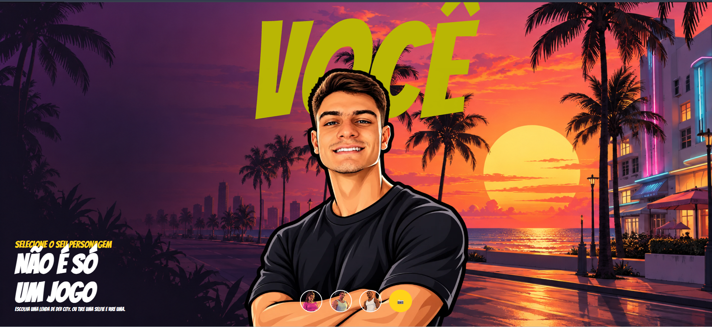

# 🎮 Entre no GTA 6

Coloque sua foto e vire um personagem do GTA 6 — direto no navegador, sem instalar nada.

Projeto de **Programação com IA** em homenagem ao lançamento do GTA 6.

## 📸 Demo

## 🔑 Antes de começar: você precisa de uma conta no Puter

O projeto roda IA direto no navegador usando o **Puter.js**. Para a transformação funcionar, é obrigatório ter uma **conta gratuita no Puter**:

1. Acesse [puter.com](https://puter.com)
2. Clique em **Sign Up** e crie sua conta (é grátis, leva 1 minuto)
3. Pronto — quando você enviar sua foto no projeto, o Puter pede login automaticamente

> ⚠️ Sem a conta, a IA não roda e a foto não é transformada.

## 🕹️ Como usar

1. Clique em **Code → Download ZIP** (botão verde aí em cima)
2. Extraia o arquivo zipado
3. Abra o arquivo `index.html` no seu navegador
4. Faça upload da sua foto
5. Faça login no Puter quando pedir (só na primeira vez)
6. Veja sua versão personagem do GTA aparecer na tela 🎉

Se o seu navegador bloquear algo, rode um servidor local na pasta do projeto com `npx serve` (precisa do Node) e abra o endereço que ele mostrar.

## 🧠 Como funciona

1. Você faz upload da sua foto no navegador
2. O projeto envia a foto para a IA do **Puter.js** com um prompt pedindo a versão da imagem no estilo dos personagens do GTA
3. A IA gera a imagem e o resultado aparece na tela, pronto pra baixar

Tudo acontece no navegador — sem backend, sem chave de API, sem configuração. O Puter.js cuida da autenticação da conta e da chamada do modelo de IA.

## 🛠️ Tecnologias

- HTML, CSS e JavaScript
- Puter.js (IA generativa no navegador)

## ⚠️ Aviso

Projeto de fã, feito por diversão e estudo. Não tenho nenhuma afiliação com a Rockstar Games ou com a franquia GTA. As imagens são geradas por IA.

## 👨‍💻 Autor

Feito por [@hagelcodes](https://instagram.com/hagelcodes) — estudante de engenharia de software documentando a jornada.

Curtiu? Me segue lá e comenta "GTA" no Reels 😉